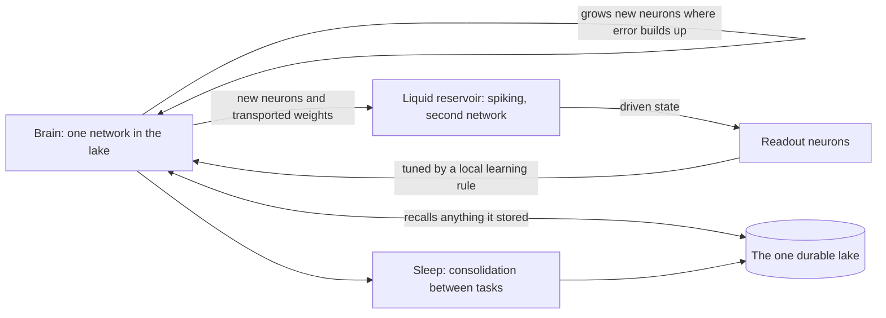

# Spiking Neural Data Lake: the SNDL Engine

[](https://www.python.org/downloads/)
[](LICENSE)

**A research project to build and test one thing: the SNDL Engine, a brain that grows its own neurons, solves problems through a spiking reservoir, and keeps everything it learns in a durable lake.**

The project's focus is the SNDL Engine, defined in the development policies
([P4d](docs/POLICIES.md)). In the policy's words: the brain, one network inside the one lake, "grows
NEW NEURONS to solve a problem and feeds them into the LIQUID RESERVOIR, a second network into which
it also transports weights. READOUT NEURONS, driven by the reservoir and tuned by the brain through a
learning rule, return to the brain, which recalls anything in the lake because it lives there." The
owner's current ruling is that the engine is the whole project: every task is engine work, and the
robot arm, the cockpit, and the storage layer exist to serve it.

**Status, 2026-11-07:** the parts of the engine exist as runnable code, and a few have measurements.
The engine as a whole has not been tested against its deciding experiment, and no measurement yet
shows that it outperforms simpler alternatives. This README says what is built, what is measured, and
what comes next, with the limits attached to each number.

## The SNDL Engine



- **Growth.** The brain adds small column-sized batches of neurons only while a problem's solved
  predicate fails on held-out data. Every grown neuron carries a position, layer, sign, region label,
  and the problem that grew it.
- **The reservoir.** A recurrent spiking pool whose output the readout neurons read. Only spiking
  candidates are selectable.
- **Local learning.** Readout neurons are tuned by local rules (e-prop and a delta readout), never
  backpropagation through time.
- **The lake.** The brain lives in the lake: its events, its grown state, and its history are
  durable, so a restart is a continuation.
- **Brain regions are labels read off an anatomical map, not code packages.**

Everything else in the repository (the SO-101 robot arm, the cockpit, the telemetry, the storage
query engine) is supporting infrastructure for that engine.

## What is built, and what is measured

| Part | Built | Where |
|---|---|---|
| Growth | Neurogenesis with solved-predicate stopping, function-preserving widening | [neurogenesis](src/snn_data_lake/growth/neurogenesis_engine.py) |
| Reservoir | Spiking recurrent pool and kernel tick | [pool](src/snn_data_lake/reservoir/recurrent_pool.py) |
| Readout | Online delta readout, a local learning rule | [online readout](src/snn_data_lake/readout/online_readout.py) |
| Brain and lake | The wake and sleep loop, durable event storage | [brain](src/snn_data_lake/engine/brain.py), [daemon](src/snn_data_lake/engine/learn_daemon.py) |
| Sleep | Episode consolidation | [consolidation](src/snn_data_lake/sleep/episode_consolidation.py) |

**Built but not yet connected.** At this commit the reservoir kernel runs only on the posed-problem
path ([readout/posed_problem.py](src/snn_data_lake/readout/posed_problem.py)); the brain's default
tick does not reach it (by static reading; the first deciding step measures it). Making the reservoir tick on the default path is the first step of the
deciding sequence below, and until it lands the engine is not exercised end to end.

**Measured so far.** These results come from the development record. Some raw evidence is in
`specs/022-unified-brain-arc/evidence/`; the rest is in the development record, unreplicated by an outside reader. Each carries its scope.

| Result | Number | Scope and limit |
|---|---|---|
| Spoken digits (SHD), 512-neuron e-prop spiking ear | 82.63 +/- 0.52 % over 4 seeds (the spread is a standard deviation, not a confidence interval), 512 neurons | Test split read once and now spent, and its pre-registered verdict was not issued; every later SHD claim is development-split only, and the default ear saw development speakers, so numbers through it are report-only; the comparison with a published figure is not licensed |
| Recipe versus base at width 64 (SAME64) | +8.91 percentage points mean, 12 of 12 seeds positive | Development split, part-level, upper-biased |
| Local rule versus BPTT twin (E1) | e-prop probe 26.0 % against a chance band of 8.59 %, BPTT twin 23.0 %; cosine between e-prop and BPTT gradients 0.994 to 1.000 | The local rule is not the bottleneck on that probe; a probe, not a task result |
| Live brain hears audio | 52 of 200 correct, identical to the standalone encoder | A wiring proof, not an accuracy gain |
| Carried versus settled reservoir state (G1(c)) | Difference -0.0074 (carried slightly below settled), a null on the pre-registered question | Stream-null: that stream had no usable history, so it does not transfer to streams with history |
| Planner weight in the prefrontal planner (plan_w) | Harm at look 10 (t 1.916 against a bound of 1.896) | Mechanism deleted under its own failure rule; not a growth result |
| Copy-and-rescale growth | Six grown units collapsed to two distinct columns | Structural null; deleted, nothing built on it |

Nothing measured so far supports calling the engine a better architecture. What exists is a
combination (growth on demand, a spiking reservoir, local-only learning, persistence as the brain)
that the project's one literature survey did not find occupied, which is a statement about the
survey's reach first. The deciding experiments have not run.

## The deciding path

The engine is judged by a fixed order of experiments, each pre-registered before its data, with the
last one deciding:

1. **Reservoir on the default path (D14).** The brain's default tick drives the reservoir, shown by an
   exact tick count and a restart test.
2. **Raw-frame input (CI-IN).** A fixed 700-channel frame source on a dedicated brain, an owner-ruled
   change that also versions the lake's percept encoding.
3. **A new carried-versus-settled test**, placed after CI-IN, on the CI-IN frame stream, pre-registered, with a history
   check and an impulse-response known positive. The earlier result on this question was a null on a
   stream with no usable history.
4. **Class-incremental learning, first run (CI1).** Twenty spoken-digit classes in ten two-class
   tasks, development split only; this run uses the default grower alone as the forgetting and
   rehearsal baseline, and it makes no claim.
5. **Task-scoped buffer (CI0).** The grower learns from the current task only, with frozen past
   columns; this makes the claim arm rehearsal-free.
6. **CI1 claim arm, against the equal-size replay baseline.** Pass only if the engine keeps at least half of replay's gain over the
   forgetting floor.
7. **Remaining engine parts**, in plan order.
8. **The full-engine test (G9), last**, with every arm paired.

A pass at step 6 would license one sentence about one task under one protocol. It would not license a
statement about general capability.

## Development policies in one paragraph

[docs/POLICIES.md](docs/POLICIES.md) governs every change. The rules that bind most work: **P2**
adopt a better mechanism or merge, then retire the inferior one, porting any unique capability first;
**P3** no dormancy, because a mechanism that is reachable but not charged does not count; **P8** an
invented method owes a reachable failing case, a control that is not the method itself, per-item
attribution, and deletion on a null. Learning is e-prop, not backpropagation. Work follows verify-first:
probe, act, prove, then commit, one change per commit with the full local gate green, and runtime
evidence outranks reading the code. Sample sizes are measured and campaigns run as pre-registered
sequential designs.

## Install from source

The current tree requires **free-threaded CPython 3.14 (`3.14t`)**. Packaging declares Python
`>=3.14`; the runtime additionally checks the free-threaded build. Ordinary GIL-enabled Python
3.14 is not the supported daemon runtime.

Use your installed **3.14t** interpreter as `python` below, then create a virtual environment:

```bash
git clone https://github.com/Aighluvsekks/Spiking-Neural-Data-Lake
cd Spiking-Neural-Data-Lake
python -c "import sys, sysconfig; print(sys.version); assert sysconfig.get_config_var('Py_GIL_DISABLED'), 'Use CPython 3.14t'"
python -m venv .venv
```

Activate it with `.venv\Scripts\Activate.ps1` in Windows PowerShell, or
`source .venv/bin/activate` on Linux/macOS. Then install:

```bash
python -m pip install -e .
```

The core dependencies in [pyproject.toml](pyproject.toml) include `torch`, `numpy`, `pyarrow`,
`mujoco==3.11.0`, and `brian2==2.10.1`, plus psutil, threadpoolctl, scipy, and networkx. Brian2 reference simulations run in an isolated subprocess
because its CPython 3.14t extension enables the GIL; the long-lived brain process stays
free-threaded. There is no supported torch-free mode. CPU execution is enough for the basic demo.

Install only the extras needed for your work:

```bash
python -m pip install -e ".[dev,nir]"  # tests, lint, and manifest/NIR checks
python -m pip install -e ".[arm]"      # serial hardware interface
```

## Run a first experiment

Start with the deterministic simulation demo:

```bash
snn-demo
```

It recognizes an approaching or retreating hand from example sensor windows, maps the result to an
arm command, and demonstrates an emergency stop on contact. It uses a throwaway persistence
directory. This demonstrates the component path, not the engine.

Inspect the storage and efficiency examples:

```bash
python -m snn_data_lake.substrate.spike_telemetry_hub
python -m snn_data_lake.substrate.paradigm_b_engine
python -m snn_data_lake.instruments.energy
```

To run the persistent local system from the source checkout:

```bash
python learn_daemon.py
```

The cockpit is served at `http://127.0.0.1:8137/`. Persistent data defaults to `~/.snn_data_lake`;
set `NORD_HOME` to choose a different directory before launching. The daemon changes persistent
state, and source self-modification is opt-in through `NORD_SELFMOD` and disabled by default. Use
isolated state for experiments and keep the exact configuration.

Real-arm operation requires calibration and the procedures in [SECURITY.md](SECURITY.md) and
[hardware setup](docs/HARDWARE_SETUP.md). Every arm command passes through `So101Arm.apply()`; the
serial path refuses uncalibrated operation.

## Validation: the local gate is the gate

CI has been disabled since 2026-08-20 (its last run, of the workflow in [ci.yml](.github/workflows/ci.yml), failed on the Python 3.14t self-checks and the test job); the local gate is the gate.
Use the free-threaded environment with the
development extras:

```bash
python run_selfchecks.py
python -m pytest
python -m ruff check .
python -m ruff format --check src tests tools
python tools/citation_guard.py
python tools/red_reachability.py --assert
python tools/dependency_ledger.py --assert
python tools/doc_command_guard.py --assert
```

Passing software checks does not establish a scientific result. Every result needs its task,
baseline, hardware, seed protocol, raw observations, and limitations. Follow
[CONTRIBUTING.md](CONTRIBUTING.md) and [the governing policies](docs/POLICIES.md) when changing code.
Earlier component-level results are measured and recorded: sparse telemetry storage (7.7x or 61x smaller than dense rasters), the energy example's SynOps count (an analytical estimate, not measured joules), the width experiment SC-012a, the neuron-paging null, and the C0 everyday-reasoning battery. See the [current-state assessment](docs/RESEARCH_ASSESSMENT.md) and the [research plan](docs/ACADEMIC_RESEARCH_PLAN.md) for their scope and limits.

## Repository map

| Path | Contents |
|---|---|
| `src/snn_data_lake/growth/`, `reservoir/`, `readout/`, `sleep/` | The engine's growth, reservoir, readout, and sleep parts |
| `src/snn_data_lake/engine/` | The brain loop and the local daemon |
| `src/snn_data_lake/substrate/` | The durable lake and its query engines |
| `src/snn_data_lake/brainstem/` | The SO-101 arm body and its safety gate |
| `tests/` | Automated regression tests |
| `specs/022-unified-brain-arc/` | The development plan, task records, and experiment evidence |
| `docs/` | Policies, architecture, operation, and research assessment |
| `tools/` | Repository checks and recorded measurements |
| `research/`, `training/`, `integrations/`, `native/` | Experimental methods, training, integrations, and native code |

Some older documents describe superseded runtimes or experiments. Executable configuration and
dated evidence take precedence over historical summaries. See [CHANGELOG.md](CHANGELOG.md) for
history and [LICENSE](LICENSE) for the MIT license.
