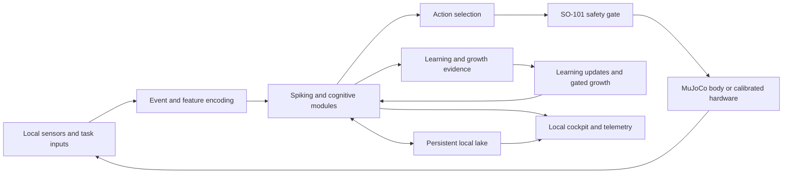

# Spiking Neural Data Lake

[](https://www.python.org/downloads/)
[](LICENSE)

**A research platform for locally adaptive spiking agents, persistent event memory, and robot control.**

Spiking Neural Data Lake (SNDL) explores a practical question: can an agent learn from local
experience, retain what it learns, and add useful capacity while staying within an affordable
computer's memory, latency, and energy budgets?

The repository combines spiking computation, a durable data lake, growth and learning mechanisms,
and a MuJoCo SO-101 robot-arm body. A local daemon and cockpit expose the running system. The
long-term ambition is a brain that develops on its owner's machine; the current implementation
is an experimental platform for testing parts of that ambition.

**Status, assessed 2026-09-20 at local commit `0fd6db5`:** runnable components and substantial
evaluation infrastructure exist. End-to-end energy savings, useful autonomous growth on inexpensive
edge hardware, and broad reasoning ability have not been established. The
[current-state assessment](docs/RESEARCH_ASSESSMENT.md) records publication validation and
distinguishes fresh checks from historical results; the
[research and presentation plan](docs/ACADEMIC_RESEARCH_PLAN.md) defines the next study.

## Why combine spikes, memory, and growth?

Many deployed models have a fixed architecture and rely on a separate training workflow when their
environment changes. SNDL investigates three complementary mechanisms:

- **Sparse activity:** represent events as spikes and exploit their timing or inactivity where the
  implementation and hardware can benefit.
- **Persistent experience:** keep observations and learned state in a local lake, with indexed
  reads, replay, recovery, and explicit retention rules.
- **Adaptive capacity:** add or change capacity in response to learning evidence, while measuring
  whether the change improves held-out behavior.

These are research mechanisms, not automatic efficiency guarantees. A spike count is not a power
measurement, a larger network is not necessarily a better learner, and a growing disk store does
not demonstrate bounded whole-system RAM use.

## What is implemented

| Area | Current implementation | Main entry points |
|---|---|---|
| Spiking computation and learning | Neuron models, encoders, plasticity rules, recurrent and reservoir components, and task-specific learners | [Package and region registry](src/snn_data_lake/__init__.py), [brain](src/snn_data_lake/engine/brain.py) |
| Persistent memory | Sparse event storage, windowed queries, append logs, sealed segments, replay and migration mechanisms | [Streaming hub](src/snn_data_lake/substrate/streaming_hub.py), [lake engine](src/snn_data_lake/substrate/lake_engine.py), [persistence paths](src/snn_data_lake/substrate/home.py) |
| Temporal queries | Coincidence and ordered-sequence matching over stored spikes | [Query engine](src/snn_data_lake/substrate/paradigm_b_engine.py) |
| Growth | Neurogenesis, local growth-program infrastructure, function-preserving widening, and stopping gates tied to learning evidence | [Neurogenesis](src/snn_data_lake/growth/neurogenesis_engine.py), [growth program](src/snn_data_lake/growth/growth_program.py), [growth stop](src/snn_data_lake/growth/growth_stop.py) |
| Robotics | Six-DOF SO-101 simulation, gesture-to-command examples, reflexes, and a calibration-gated serial path | [SO-101 body](src/snn_data_lake/brainstem/so101_arm.py), [demo](src/snn_data_lake/infra/demo.py), [safety documentation](SECURITY.md) |
| Local runtime | Daemon, cockpit, telemetry, and provenance-aware capability reporting | [Daemon](src/snn_data_lake/engine/learn_daemon.py), [cockpit](src/snn_data_lake/infra/cockpit.py) |
| Evaluation | Deterministic self-checks, pytest, fault controls, policy gates, replay checks, and recorded experiments | [Self-check runner](run_selfchecks.py), [tests](tests/), [experiment records](specs/022-unified-brain-arc/evidence/) |

The system uses a mixture of spiking, tensor, symbolic, and conventional Python components. Brain
region names label parts of the implementation; they do not establish biological equivalence. Software
in `research/`, `integrations/`, and other tiers remains part of the project, with gaps in governance
treated as engineering debt under [the development policies](docs/POLICIES.md).

## Architecture



This is a conceptual map of existing subsystems, not a claim that every path has demonstrated a
task-level benefit. The [connectome](src/snn_data_lake/connectome.py) and the
[unified-brain development plan](specs/022-unified-brain-arc/PLAN-FINAL-2026-09-02.md) describe the
implementation and its outstanding work.

## Install from source

The current tree requires **free-threaded CPython 3.14 (`3.14t`)**. Packaging declares Python
`>=3.14`; the runtime additionally checks the free-threaded build. Ordinary GIL-enabled Python
3.14 is not the supported daemon runtime. This differs from older releases and older installation
notes.

Use your installed **3.14t** interpreter as `python` below, then create a virtual environment:

```bash
git clone https://github.com/Aighluvsekks/Spiking-Neural-Data-Lake
cd Spiking-Neural-Data-Lake
python -c "import sys, sysconfig; print(sys.version); assert sysconfig.get_config_var('Py_GIL_DISABLED'), 'Use CPython 3.14t'"
python -m venv .venv
```

Activate it with `.venv\Scripts\Activate.ps1` in Windows PowerShell, or
`source .venv/bin/activate` on Linux/macOS. Then install:

```bash
python -m pip install -e .
```

The five core dependencies in [pyproject.toml](pyproject.toml) are `torch`, `numpy`, `pyarrow`,
`mujoco==3.11.0`, and `brian2==2.10.1`. Brian2 is the canonical spiking simulator; Torch remains
the tensor/autograd engine. Brian2 reference simulations run in an isolated subprocess because its
CPython 3.14t extension enables the GIL; the long-lived brain process stays free-threaded and uses
the parity-checked Torch bridge. There is no supported torch-free mode. CPU execution is
part of the CI configuration; CUDA is useful for selected workloads, not a requirement for the
basic demo. Edge-device wheel availability must be checked before choosing deployment hardware.

Install only the extras needed for your work:

```bash
python -m pip install -e ".[dev,nir]"  # tests, lint, and manifest/NIR checks
python -m pip install -e ".[arm]"      # serial hardware interface
```

Other extras are declared in `pyproject.toml`. The `all` extra is a selected bundle and does not
include every optional integration. Historical release binaries are separate artifacts; this
README describes the assessed source tree.

## Run a first experiment

Start with the deterministic simulation demo:

```bash
snn-demo
```

It recognizes an approaching or retreating hand from example sensor windows, maps the result to
an arm command, and demonstrates an emergency stop on contact. It uses a throwaway persistence
directory. This demonstrates the component path, not learned real-world manipulation.

Inspect the storage and efficiency examples:

```bash
python -m snn_data_lake.substrate.spike_telemetry_hub
python -m snn_data_lake.substrate.paradigm_b_engine
python -m snn_data_lake.instruments.energy
```

To run the persistent local system from the source checkout:

```bash
python learn_daemon.py
```

The cockpit is served at `http://127.0.0.1:8137/`. Persistent data defaults to
`~/.snn_data_lake`; set `NORD_HOME` to choose a different directory before launching. The daemon
changes persistent state. Source self-modification is separately opt-in through `NORD_SELFMOD`
and is disabled by default. Use isolated state for experiments and retain the exact configuration.

Real-arm operation requires calibration and the procedures in [SECURITY.md](SECURITY.md) and
[hardware setup](docs/HARDWARE_SETUP.md). Every arm command passes through `So101Arm.apply()`;
the serial path refuses uncalibrated operation. Simulation results do not certify physical safety
or real-arm learning.

## Evidence and its limits

The following component examples were rerun during the 2026-09-20 assessment. They are fixed
workloads, not an edge-device benchmark suite.

| Experiment | Observed result | What it supports |
|---|---|---|
| Sparse telemetry storage | 103,723 events: 417,976 B versus a 3,200,000 B bit raster or 25,600,000 B byte raster | About 7.7x or 61x less storage, depending on the dense representation |
| Windowed telemetry query | 8,492 B read, about 2.0% of that sparse file | Indexed partial reading for the specified channels and time window |
| Temporal query engine | Ordered motif: 41 forward matches versus 4 reverse matches; 1.3% of the file read for that query | Order-sensitive matching and partial reads on a constructed workload |
| Gesture-to-arm demo | HOLD, ENGAGE, RELEASE, then EMERGENCY_STOP on contact | Runnable simulation integration and a demonstrated reflex path |

**The efficiency baseline matters.** The [energy example](src/snn_data_lake/instruments/energy.py)
counts 113,676 SynOps. A dense comparison repeated over 20 time steps costs 409,600 MACs, producing
the older 3.6x reduction headline. A single dense pass over the static input costs 20,480 MACs:
the spiking example then uses about **5.6x more operations**. SynOps and MACs also have different
costs. With its modeled memory-access costs and INT8 baseline, this example estimates 740.4 nJ for
the SNN versus 107.1 nJ for the ANN. These are **analytical energy estimates**, not measured joules
on a CPU, GPU, robot, or neuromorphic chip.

Recorded development results further constrain the claims:

- **Width helped one prediction task, within important limits.** The corrected SC-012a experiment
  reported a 15.1 percentage-point mean next-category accuracy gain for the wider arm over one
  unit across eight seeds. The wider arm realized 9-14 units; it did not beat the incumbent's own
  admission policy or the simple previous-category baseline. Review also found its shuffled-label
  veto could not discriminate failure. This is bounded task evidence, not an edge-efficiency result.
  See sections 7-8 of the [corrected reading and review](specs/022-unified-brain-arc/evidence/sc-012a-width.md).

- **Neuron paging did not meet its full criterion.** The recorded experiment reduced memory but
  reported a median raw tick-time ratio of 35.2x against a 3.0x bound. The paging layer was deleted
  under the predefined failure rule. Durable event storage remains a separate capability.
  See the [paging record](specs/022-unified-brain-arc/evidence/s5-paging-null.md) and
  [exit assessment](specs/022-unified-brain-arc/evidence/s2-exit.md).
- **Everyday reasoning remains limited.** The pinned C0 campaign records 0/20 correct on each of
  five seeds: 14 abstentions, five unrelated retrieved rows, and one self-report per seed. Its
  `MET` verdict certifies the scoring instrument and its controls, not reasoning success. The
  assessment re-derived all 144 recorded classifications without disagreement; it did not rerun
  that campaign. See the [protocol](specs/022-unified-brain-arc/evidence/c0-everyday-battery.md) and
  [pinned data](tools/c0_everyday_battery.json).

## Research direction: affordable local adaptation

The proposed study asks whether **budgeted growth plus persistent experience improves the
quality-cost tradeoff of an adaptive robot controller** against strong fixed-size alternatives
on the same machine.

The next evidence should include:

1. A bounded continual-control task with held-out goals and reproducible environment changes.
2. Fixed-size spiking, compact dense, and classical-control baselines, with matched inputs,
   training opportunities, and tuning budgets.
3. Growth and memory ablations to identify which mechanism causes any improvement.
4. Whole-process peak RAM, p50/p95 latency, measured energy, disk growth, adaptation time, and
   retained task performance, including preprocessing and learning costs.
5. A reproducible CPU-only run on a modest local machine before any inexpensive-edge claim.

## Validation and contributing

Use the free-threaded environment with the development and NIR extras:

```bash
python run_selfchecks.py
python -m pytest
python -m ruff check .
python -m ruff format --check src tests tools
python tools/citation_guard.py
python tools/red_reachability.py --assert
python tools/dependency_ledger.py --assert
python tools/doc_command_guard.py --assert
```

[The workflow](.github/workflows/ci.yml) defines the CI configuration. **The GitHub workflow was
manually disabled when checked on 2026-09-20; a push alone does not run these jobs.** Local
validation is recorded in the assessment and does not establish a fresh cross-platform CI pass.
The configuration includes self-checks on
Windows and Ubuntu with Python 3.14t, wheel-content checks, lint and policy gates, and pytest with
a 70% coverage floor. Coverage excludes the reasoning and training tiers; that floor is not
whole-repository coverage. Additional checks cover replay, determinism, manifests, growth, and
policy reporting. The certification job is advisory (`continue-on-error`); performance reporting
in shared CI is also non-asserting. The documentation-command guard runs in `run_selfchecks.py`'s tools stage
(not in the workflow) *(corrected 2026-10-29; it was described as a manual check)*.

Passing software checks does not establish a scientific result. Every result needs its task,
baseline, hardware, seed protocol, raw observations, and limitations. Follow
[CONTRIBUTING.md](CONTRIBUTING.md) and [the governing policies](docs/POLICIES.md) when changing code.

## Repository map

| Path | Contents |
|---|---|
| `src/snn_data_lake/` | Brain modules, storage, learning, control, runtime, and instrumentation |
| `tests/` | Automated regression tests |
| `specs/022-unified-brain-arc/` | Current development plan, task records, and experiment evidence |
| `research/` and `training/` | Experimental methods and training work |
| `integrations/` | Hardware, packaging, desktop, and optional local-model integrations |
| `docs/` | Architecture, operation, research assessment, and presentation plan |
| `tools/` | Repository checks and recorded measurements |

Some older documents describe superseded runtimes or experiments. For this assessment, executable
configuration and dated evidence take precedence over historical summaries. Consult
[CHANGELOG.md](CHANGELOG.md) for development history and [LICENSE](LICENSE) for the MIT license.
